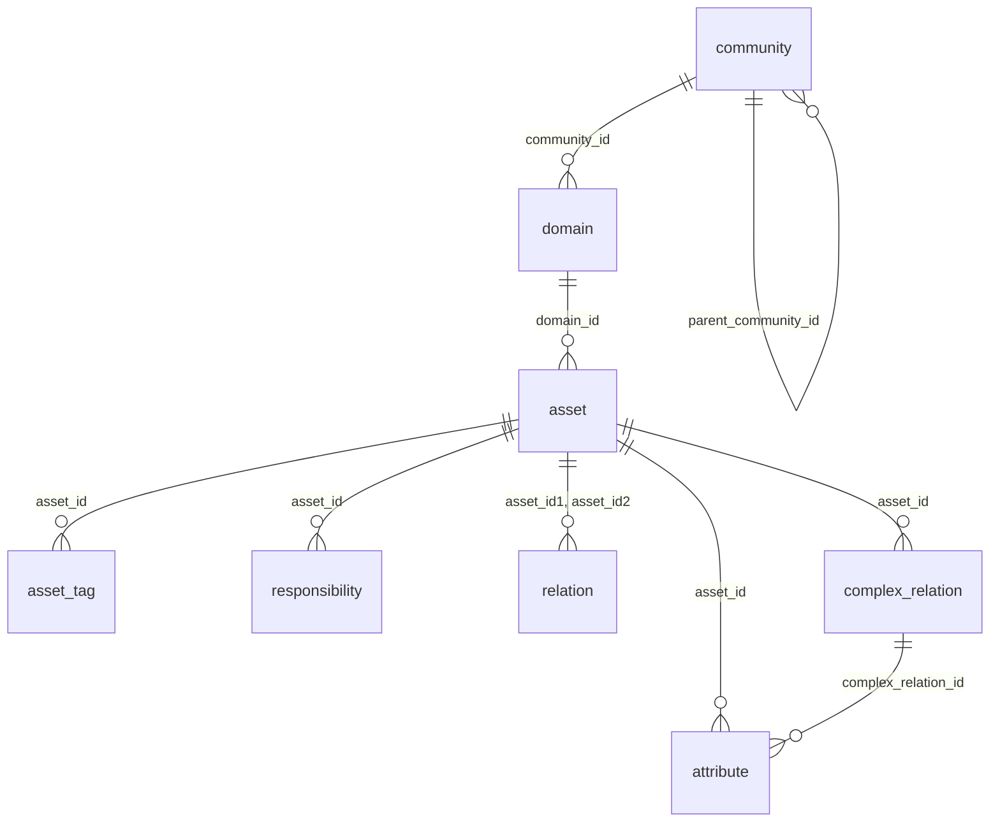

# Data dictionary: what is inside an Insights snapshot

Observed on a real snapshot (2026-10-10). Types are as read from the Parquet files. Statements are marked **verified** (checked with a query on real data), **inferred** (from names and counts, not proven) or **unknown**.

## How the tables connect

Plain words: **communities** contain **domains**, domains contain **assets**. Everything else describes assets: their **attributes** (definition, owner-entered fields…), **tags**, **relations** to other assets, and **responsibilities** (who owns or stewards them).

## Conventions that apply to every table

| Convention | Detail |
|---|---|
| Ids | `VARCHAR` UUIDs. Join on these, never on names |
| `snapshot_date` | `DATE`, the day the copy was taken. Present on every table. `snapshot_date_year/month/day` (`BIGINT`) are the folder partitions and repeat the same information |
| Audit columns | `creator_user_id`, `creator_username`, `creation_date` (TIMESTAMP), `editor_user_id`, `editor_username`, `edited_date` (TIMESTAMP). On every table; omitted from the column lists below |
| Names are denormalised | e.g. `asset_type_name` appears on `attribute` and `relation`; fewer joins needed |
| Not in the export | Collibra "meta" objects (see [known-gaps.md](known-gaps.md)): a few rows point at ids that are not in the tables |
| No user table | Users appear only inside `responsibility` |
| No relation-type names | `relation` has `relation_type_id` and a role label, but no relation-type name |

---

## `community`: the community hierarchy

**Grain: one row per community per ancestor level**, a root-to-self path (**verified**: 357 rows for 187 communities; a community at depth *d* has levels 1..*d*; level *d* is itself; deepest = 4; 62 roots).

| Column | Type | Meaning |
|---|---|---|
| `community_id`, `community_name`, `community_description` | VARCHAR | The community |
| `is_community_system` | BOOLEAN | Built-in community (4 of 187) |
| `uri` | VARCHAR | Collibra URI of the community |
| `parent_community_id` | VARCHAR | Direct parent; null for roots |
| `level` | INTEGER | Position on the path: 1 = root … *depth* = the community itself |
| `level_community_id`, `_name`, `_description`, `_uri` | VARCHAR | The ancestor at that `level` |

Because rows repeat, **`count(*)` over `community` is wrong**; count distinct `community_id`, or use `dim_community`.

## `domain`: one row per domain

Verified unique (585 rows, 585 ids).

| Column | Type | Meaning |
|---|---|---|
| `domain_id`, `domain_name`, `domain_description`, `domain_uri` | VARCHAR | The domain |
| `domain_type_id`, `domain_type_name`, `domain_type_description` | VARCHAR | Its type (Glossary, Physical Data Dictionary, Codelist…) |
| `is_domain_system` | BOOLEAN | Built-in domain (194 of 585: 187 *Issues Vocabulary Type* plus 7) |
| `community_id` | VARCHAR | Parent community. One domain's community is missing from the export |

## `asset`: one row per asset

Verified unique (23,202 rows, 23,202 ids). Includes assets of custom types.

| Column | Type | Meaning |
|---|---|---|
| `asset_id`, `asset_full_name`, `asset_display_name` | VARCHAR | The asset. `full_name` is unique within a domain; `display_name` is what users see |
| `domain_id` | VARCHAR | Parent domain. **14 assets** point at a domain missing from the export |
| `asset_type_id`, `asset_type_name` | VARCHAR | Business Term, Table, Column… |
| `status_id`, `status_name` | VARCHAR | Workflow status (Approved, Candidate…) |
| `articulation` | DOUBLE | Collibra's articulation score for the asset. **Unknown** how it is computed |
| `ratings_average` (DOUBLE), `ratings_count` (INTEGER) | | User ratings |
| `is_asset_system` | BOOLEAN | Built-in asset; none in this export |

## `asset_tag`: one row per tag on an asset (**inferred**)

147 rows. `tag_id`, `tag_name`, `asset_id`, `is_tag_system` (BOOLEAN).

## `attribute`: one row per attribute value (**inferred**)

An entity-attribute-value table: every kind of attribute (Definition, Description, custom fields) lives here.

| Column | Type | Meaning |
|---|---|---|
| `attribute_id` | VARCHAR | The attribute instance |
| `asset_id` | VARCHAR | Owning asset |
| `asset_type_name` | VARCHAR | Type of that asset (denormalised) |
| `attribute_type_id`, `attribute_type_name`, `attribute_type_description` | VARCHAR | What the attribute *is* ("Definition"…) |
| `kind` | VARCHAR | STRING, NUMERIC, BOOLEAN, DATE, SINGLE_VALUE_LIST, MULTI_VALUE_LIST, SCRIPT |
| `expression_long` | VARCHAR | Text of the value. Filled for essentially every kind (**verified**) |
| `numeric_value` | DOUBLE | Set for NUMERIC (all rows) |
| `boolean_value` | BOOLEAN | Set for BOOLEAN (all rows) |
| `datetime_value` | DATE | Set for DATE (all rows) |
| `is_attribute_integer` | BOOLEAN | Whether a numeric value is an integer |
| `complex_relation_id` | VARCHAR | Set when the attribute belongs to a complex relation. Whether `asset_id` is then null: **not checked** |

Value rule (**verified** by counts): lists, strings and scripts use `expression_long` only; numbers, booleans and dates also fill their typed column. Use the typed column to compute with, `expression_long` to display. Long text may contain HTML. How multi-value lists are separated inside `expression_long`: **unknown**.

## `relation`: relationships between two assets

**Grain: every relationship is stored twice**, once per direction (**verified**: 54,720 rows = 2 × 27,360 `relation_id`s; the two rows are exact mirrors).

| Column | Type | Meaning |
|---|---|---|
| `relation_id` | VARCHAR | The relationship (appears in both rows) |
| `relation_type_id` | VARCHAR | Its type. **No type name available** |
| `direction` | VARCHAR | `head -> tail` or `tail -> head` |
| `role_or_corole` | VARCHAR | The role label for this row's direction. Values not inspected |
| `asset_id1`, `asset_type_id1`, `asset_type_name1` | VARCHAR | First asset of this row |
| `asset_id2`, `asset_type_id2`, `asset_type_name2` | VARCHAR | Second asset of this row |
| `is_relation_generated` | BOOLEAN | Created by Collibra rather than by a user (**inferred**) |

**Always keep one direction** (`direction = 'head -> tail'`) or you double-count. `fact_relation` does this.

## `complex_relation`: n-ary relationships

**Grain: one row per participating asset** (9,710 rows / 4,823 relations ≈ 2 each; **verified** ratio, not that every relation has exactly 2).

`complex_relation_id`, `complex_relation_type_id/_name/_description`, `relation_type_id`, `relation_role` (the participant's role), `asset_id` (the participant).

## `responsibility`: who is responsible for what

20,036 rows. Grain **inferred**: one row per (resource, role, user *or* group).

| Column | Type | Meaning |
|---|---|---|
| `role_id`, `role_name` | VARCHAR | Owner, Business Steward, Community Manager… |
| `asset_id` | VARCHAR | The resource. Despite the name, **25% do not match any exported asset** (see [known-gaps.md](known-gaps.md)); 47 are null |
| `user_id`, `username`, `user_firstname`, `user_lastname`, `user_email`, `user_language`, `user_licensetype` | VARCHAR | The responsible user (**personal data**) |
| `is_user_guest`, `is_user_api`, `is_user_activated`, `is_user_enabled` | BOOLEAN | User state flags |
| `group_id`, `group_name` | VARCHAR | Set instead of a user when the role is held by a group |
| `is_responsibility_system` | BOOLEAN | Always false in this export |

Observation: no responsibility row references a domain or community id. If your organisation assigns owners at domain or community level, **inherited ownership is not visible** in this table.

## Not present

**Usage Analytics view events** are documented by Collibra as part of Insights but there is **no such table** in this export (8 folders, only `.parquet`). Cause unknown; a licence or setting is the likeliest explanation.
