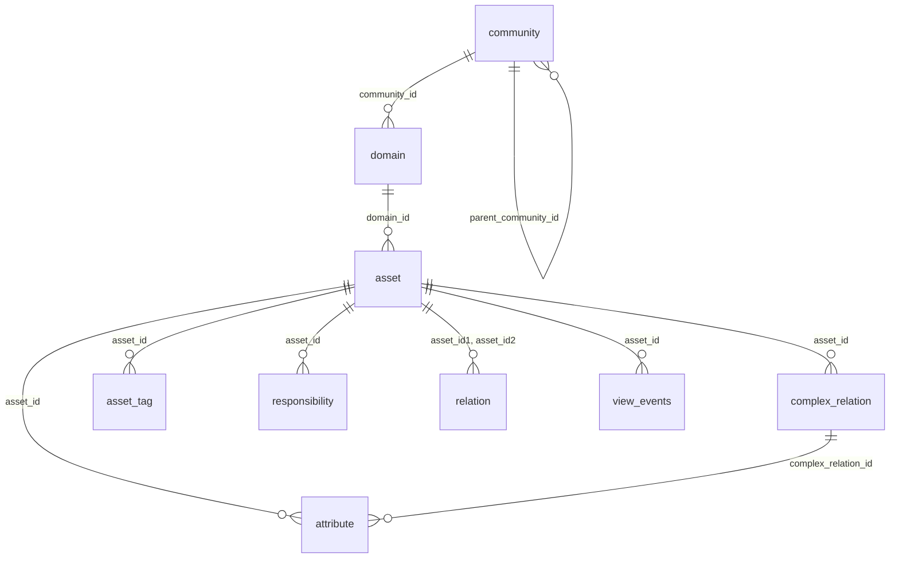

# Data dictionary: what is inside an Insights snapshot

Sources: Collibra's official *Entity relationship diagram* and *Insights tables* pages, **checked against a real snapshot** from a reference instance. Where the two differ or where something was verified, it is said. Types are simplified (text, number, date…); the real files use DuckDB/Parquet types.

## How the tables connect



In words: **communities** contain **domains**, domains contain **assets**. Everything else describes assets: **attributes**, **tags**, **relations**, **responsibilities**, and (optionally) **view events**.

> **Official rule:** to combine tables for a given date, **every join must include `snapshot_date`.** Joining on ids alone mixes snapshots.

## Joining the raw tables

**Every join includes `snapshot_date`** (official rule). The join keys, with what to expect:

| From → to | Join on (plus `snapshot_date`) | Rows per left row | Watch out |
|---|---|---|---|
| `asset` → `domain` | `asset.domain_id = domain.domain_id` | 1 | a few assets point at a domain missing from the export: use `LEFT JOIN` |
| `domain` → `community` | `domain.community_id = community.community_id` **and `community.community_id = community.level_community_id`** | 1 | without the second condition a community matches once per level |
| `asset` → `attribute` | `attribute.asset_id = asset.asset_id` | 0..n | filter on `attribute_type_name`; one asset has many attributes |
| `attribute` → `complex_relation` | `attribute.complex_relation_id = complex_relation.complex_relation_id` | **1 per leg** | the attribute repeats once for each leg of the relation |
| `asset` → `asset_tag` | `asset_tag.asset_id = asset.asset_id` | 0..n | |
| `asset` → `relation` | `relation.asset_id1 = asset.asset_id` (and/or `asset_id2`) | 2 per relationship | stored twice: filter `direction = 'head -> tail'` |
| `asset` → `complex_relation` | `complex_relation.asset_id = asset.asset_id` | 0..n | one row per leg |
| `asset` → `responsibility` | `responsibility.asset_id = asset.asset_id` | 0..n | ~a quarter of rows match no exported asset; null = global permission |
| `asset` → `view_events` | `CAST(view_events.asset_id AS VARCHAR) = asset.asset_id` and **an explicit asset snapshot** | 0..n | `view_events.snapshot_date` is the *event* date, not an asset snapshot |

Worked examples (they run on the raw tables):

```sql
-- the asset > domain > community path
SELECT a.asset_display_name, d.domain_name, c.community_name
FROM asset a
LEFT JOIN domain d ON d.snapshot_date = a.snapshot_date AND d.domain_id = a.domain_id
LEFT JOIN community c ON c.snapshot_date = d.snapshot_date
                     AND c.community_id = d.community_id
                     AND c.community_id = c.level_community_id
```

```sql
-- an asset with its definition text
SELECT a.asset_display_name, t.expression_long AS definition
FROM asset a
JOIN attribute t ON t.snapshot_date = a.snapshot_date AND t.asset_id = a.asset_id
WHERE t.attribute_type_name = 'Definition'
```

```sql
-- both ends of every relationship, one direction only
SELECT r.relation_id, a1.asset_display_name AS head, a2.asset_display_name AS tail
FROM relation r
JOIN asset a1 ON a1.snapshot_date = r.snapshot_date AND a1.asset_id = r.asset_id1
JOIN asset a2 ON a2.snapshot_date = r.snapshot_date AND a2.asset_id = r.asset_id2
WHERE r.direction = 'head -> tail'
```

```sql
-- the legs of the complex relation an attribute belongs to
SELECT t.attribute_type_name, cr.complex_relation_type_name, cr.relation_role, cr.asset_id
FROM attribute t
JOIN complex_relation cr ON cr.snapshot_date = t.snapshot_date AND cr.complex_relation_id = t.complex_relation_id
```

```sql
-- responsibilities, keeping the ones whose asset is not in the export
SELECT r.role_name, r.asset_id, a.asset_id IS NOT NULL AS asset_in_export
FROM responsibility r
LEFT JOIN asset a ON a.snapshot_date = r.snapshot_date AND a.asset_id = r.asset_id
```

```sql
-- view events against an explicitly chosen asset snapshot
SELECT a.asset_display_name, count(*) AS views
FROM view_events v
JOIN asset a ON a.asset_id = CAST(v.asset_id AS VARCHAR)
            AND a.snapshot_date = (SELECT max(snapshot_date) FROM asset)
GROUP BY 1
```

The [modeling guide](modeling.md) packages all of this into a star schema so you rarely write these joins by hand.

---

## Conventions

| Convention | Detail |
|---|---|
| Ids | Text UUIDs. Join on ids, never on names |
| `snapshot_date` | Date of the copy. In every table (in `view_events` it is the date the event happened). `snapshot_date_year/month/day` are the folder partitions repeating it |
| Audit columns | `creator_user_id`, `creator_username`, `creation_date`, `editor_user_id`, `editor_username`, `edited_date`. On every table except `view_events`; not repeated below |
| Custom and out-of-the-box | Every table contains both (official) |
| Excluded | Asset types not manageable through the Asset Type Operating Model (Roles, Workflow Definitions…), with their attributes, communities, domains and relations (official) |
| Not available | No user table; no relation-type names (only ids and role labels) |

Keys below are the **official** primary keys.

---

## `community`

Key: `(snapshot_date, community_id, level)`. **One row per community per ancestor level.**

| Column | Meaning |
|---|---|
| `community_id`, `community_name`, `community_description` | The community |
| `is_community_system` | Built-in community |
| `uri` | Deprecated (API v1) |
| `parent_community_id` | Direct parent; null for top-level communities |
| `level` | Position on the root-to-self path; the top level is 1 |
| `level_community_id`, `_name`, `_description`, `_uri` | The community at that level |

Official tip: a `community_id` spans several rows; **to isolate the unique communities, filter `community_id = level_community_id`** (the row where the path reaches the community itself). *Verified:* every community's rows are exactly levels 1..depth and the last one is itself, so this filter yields one row each. Never `count(*)` the raw table; use `dim_community`.

## `domain`

Key: `(snapshot_date, domain_id)`.

| Column | Meaning |
|---|---|
| `domain_id`, `domain_name`, `domain_description` | The domain |
| `domain_type_id`, `_name`, `_description` | Its type (Glossary, Physical Data Dictionary, Codelist…) |
| `is_domain_system` | Built-in domain |
| `community_id` | Parent community |
| `domain_uri` | Deprecated |

Collibra's wording is domains "that contain assets", but the reference export also contained **empty** domains (232 of 585, mostly built-in *Issues Vocabulary* domains). Do not assume every domain has assets; `investigate` prints your count.

## `asset`

Key: `(snapshot_date, asset_id)`.

| Column | Meaning |
|---|---|
| `asset_id`, `asset_full_name`, `asset_display_name` | The asset (`full_name` is unique within its domain; `display_name` is what users see) |
| `domain_id` | Parent domain |
| `asset_type_id`, `asset_type_name` | Business Term, Table, Column… |
| `status_id`, `status_name` | Workflow status |
| `articulation` | The asset's articulation score (Collibra's documentation gives no formula) |
| `ratings_average`, `ratings_count` | Aggregated user ratings |
| `is_asset_system` | Built-in asset |

## `asset_tag`

Key: `(snapshot_date, tag_id, asset_id)`. One row per tag on an asset: `tag_id`, `tag_name`, `asset_id`, `is_tag_system`.

## `attribute`

Key: `(snapshot_date, attribute_id)`. An entity-attribute-value table: every kind of attribute (Definition, Description, custom fields) is a row.

| Column | Meaning |
|---|---|
| `attribute_id` | The attribute instance |
| `asset_id` | Owning asset |
| `complex_relation_id` | Owning complex relation. **Official: an attribute has two possible parents, asset or complex relation; if one has a value the other is null** |
| `asset_type_name` | Type of the owning asset (denormalised) |
| `attribute_type_id`, `_name`, `_description` | What the attribute *is* ("Definition"…) |
| `kind` | STRING, NUMERIC, BOOLEAN, DATE, SINGLE_VALUE_LIST, MULTI_VALUE_LIST, SCRIPT (observed) |
| `expression_long` | The value as text |
| `numeric_value`, `boolean_value`, `datetime_value` | The value converted to a number / boolean / date |
| `is_attribute_integer` | Whether a numeric value is an integer |

*Verified rule:* `expression_long` is filled for essentially every kind; NUMERIC also fills `numeric_value`, BOOLEAN `boolean_value`, DATE `datetime_value` (a plain date, not a timestamp); strings, lists and scripts use text only. Compute with the typed column, display the text. Long text may contain HTML. How multi-value lists are separated inside the text is not documented.

## `relation`

Key: `(snapshot_date, relation_id, direction)`. **Every relationship is stored twice**, once per direction (official: "from head to tail and vice versa"; *verified*: the two rows are exact mirrors).

| Column | Meaning |
|---|---|
| `relation_id` | The relationship; appears in both rows |
| `relation_type_id` | Its type (no type name in the export) |
| `direction` | `head -> tail` (first asset is the head) or `tail -> head` |
| `role_or_corole` | The relation's role in the head→tail direction, or its co-role in the tail→head direction |
| `asset_id1`, `asset_type_id1`, `asset_type_name1` | First asset of this row |
| `asset_id2`, `asset_type_id2`, `asset_type_name2` | Second asset of this row |
| `is_relation_generated` | Whether the relation was generated |

Keep one direction or you double-count (`fact_relation` does).

## `complex_relation`

Key: `(snapshot_date, complex_relation_id, relation_type_id)`. **One row per relation leg** (a complex relation links two or more assets).

`complex_relation_id`, `complex_relation_type_id/_name/_description`, `relation_type_id` (the leg type), `relation_role` (the leg's role), `asset_id` (the asset on that leg).

## `responsibility`

No primary key; official uniqueness: `(snapshot_date, asset_id, role_id, user_id, group_id)`.

| Column | Meaning |
|---|---|
| `role_id`, `role_name` | The **resource role** (Owner, Business Steward, Data Quality Manager…) |
| `asset_id` | The resource. **Null means a global permission** (official) |
| `user_id`, `username`, `user_firstname`, `user_lastname`, `user_email`, `user_language`, `user_licensetype` | The responsible user (**personal data**). Used only when assigned to a user |
| `group_id`, `group_name` | The responsible group. A row is for a user *or* a group |
| `is_user_guest`, `is_user_api`, `is_user_activated`, `is_user_enabled` | User state flags |
| `is_responsibility_system` | System-generated responsibility |

**What is included (official):** responsibilities assigned **directly to assets**, and those **inherited from domains** (so a domain-level owner appears as rows on the domain's assets). Responsibilities **inherited from communities are excluded.** Resource roles can also attach to **non-catalog resources** such as Data Quality jobs; see [known-gaps.md](known-gaps.md).

## `view_events` (optional)

Key: `(snapshot_date, event_id)`. Official: "all of the view events … as measured in Usage Analytics". **Not part of the eight tables of Collibra's setup guides and absent from the reference snapshot; the columns below are from Collibra's documentation and have not been checked against real data.**

| Column | Meaning |
|---|---|
| `snapshot_date` | The date the event happened |
| `event_id`, `event_time` | The event and its UTC time |
| `user_id`, `username`, `session_id` | Who viewed, in which HTTP session |
| `asset_id`, `asset_full_name`, `asset_display_name` | The asset viewed |
| `domain_id`, `domain_name`, `community_id`, `community_name` | The domain / community viewed |
| `diagram_id`, `diagram_name`, `dashboard_id`, `dashboard_name`, `view_id`, `view_name` | The diagram / dashboard / view viewed |
| `page_path`, `page_parameters`, `tab_name` | The page, its query string, and the tab (Overview, History…) |

Only events started **from the Collibra user interface** are counted (not API, Edge or mobile), and only since Usage Analytics was enabled (introduced in Collibra 2022.11; data on communities, domains, dashboards and diagrams since January 2024). Usernames and sessions are personal data.
