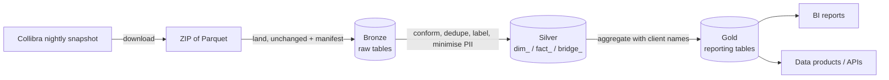

# Insights in a medallion architecture

How to run Insights data through bronze → silver → gold so that gold tables serve reporting and data products. Platform-neutral: the toolkit hands over **Hive-partitioned Parquet**, which every lakehouse engine can register; choosing the engine is the client's call.

> **Status.** The export is unit-tested on synthetic data with the real column names. It has **not yet been run on a real snapshot**, and nothing has been tried on a specific engine. Treat the first run as a pilot.

## 1. The layers, in Insights terms



| Layer | Holds | Rule | Written by |
|---|---|---|---|
| **Bronze** | the eight raw tables (plus `view_events`) exactly as delivered | never edited; the system of record and the **only way to keep history beyond Collibra's 31-day window** | `export --layer bronze` |
| **Silver** | the conformed model: `dim_*`, `fact_*`, `bridge_*` | one row means one thing; quirks removed; quality labelled, not hidden | `export --layer silver` |
| **Gold** | reporting tables and data products, additive counts | named, versioned, owned; built only from silver | `export --layer gold` |

```bash
collibra-insights download 2026-10-10
collibra-insights check    snapshots/insights-2026-10-10                      # the quality gate (section 5)
collibra-insights export   snapshots/insights-2026-10-10 --out lake --gold-config gold.json
# -> lake/bronze/insights/<table>/...   lake/silver/insights/<view>/...   lake/gold/insights/<product>/...
```
`--out` must be **separate** from the snapshot folder (the command refuses otherwise). Every output is `<name>/snapshot_date=YYYY-MM-DD/*.parquet`; re-running a day replaces exactly that day's partitions and never duplicates them.

## 2. Bronze

* **What lands:** the raw Parquet files, byte for byte, under the same table and partition layout.
* **Provenance:** every landing writes `_manifests/<utc>-<snapshot>.json` with each file's size and SHA-256, row counts per table, and any file that was *replaced* because the same path arrived with different content (a signal worth alerting on).
* **History:** Collibra keeps 31 daily snapshots, then month-ends. Insights delivers **full photos, not changes**, so bronze grows by one snapshot per day. Decide a policy: keep every day for N days, then month-ends only.
* **Schema drift:** compare `collibra-insights explore` output with the [data dictionary](data-dictionary.md) after each Collibra upgrade; new or renamed columns surface there first.

## 3. Silver

The model in [modeling.md](modeling.md) *is* the silver layer:

| Silver table | Grain | Conformance applied |
|---|---|---|
| `dim_community`, `bridge_community_ancestor` | community; community × level | repeated level rows collapsed |
| `dim_domain`, `dim_asset` | domain; asset | parents joined with `LEFT JOIN`; `is_domain_missing` flags orphans |
| `dim_user` | user | derived from responsibilities; names and email dropped |
| `fact_attribute` | attribute value | `value_as_text` always filled |
| `fact_relation` | relationship | one direction kept |
| `fact_responsibility` | responsibility | `asset_resolution` labels rows that match no asset |
| `bridge_asset_tag`, `bridge_complex_relation` | asset × tag; relation leg | as delivered |
| `fact_view_event` | page view | only if the optional table exists |

* **Keys:** `(snapshot_date, id)`. Each silver partition is a complete photo, so history needs no effective-from/to columns: a "current" view is `WHERE snapshot_date = (SELECT max(snapshot_date) FROM dim_snapshot)`.
* **Privacy:** silver minimises personal data by design. Usernames stay; first name, last name and email do not.
* **Idempotent:** the same snapshot produces the same silver partition.

## 4. Gold: the data products

Gold tables hold **additive counts, never ratios**, so any slice stays correct: compute `sum(with_definition) / sum(assets)` in the BI tool.

| Product | Grain | Measures | Answers | Typical consumer |
|---|---|---|---|---|
| `gold_governance_scorecard` | snapshot × community × domain × governed asset type | `assets`, `with_definition`, `with_owner`, `connected`, `approved`, `stale` | how well governed is each area, and is it improving | governance dashboard, steering committee |
| `gold_catalog_inventory` | snapshot × community × domain × domain type × asset type × status | `assets`, `stale_assets` | what exists and how fresh | platform owner, capacity planning |
| `gold_stewardship_workload` | snapshot × role × user | `assets`, `domains` | who carries how much | team leads |
| `gold_asset_connectivity` | snapshot × asset type | `assets`, `connected_assets`, `relation_endpoints` | how linked the catalogue is | architects |
| `gold_usage_daily` *(needs `view_events`)* | event day | `active_users`, `views` | adoption | sponsors |

**Client-specific names live in one file**, never in code. `gold.json`:
```json
{
  "governed_types": ["Business Term", "Data Set"],
  "definition_attribute": "Definition",
  "owner_roles": ["Owner", "Data Owner"],
  "approved_statuses": ["Approved"],
  "stale_days": 365,
  "include_usernames": false
}
```
List the client's real names first: `SELECT DISTINCT asset_type_name FROM dim_asset`, `… attribute_type_name FROM fact_attribute`, `… role_name FROM fact_responsibility`, `… status_name FROM dim_asset`.

### Serving gold as a data product

Give each product a contract before publishing it. Example for the scorecard:
```yaml
name: governance_scorecard
version: 1.0.0                      # bump the major version when a column is removed or its meaning changes
owner: <named team>                 # a person or team who answers questions, not "the data team"
grain: snapshot_date x community x domain x governed asset type
refresh: daily, after the Collibra snapshot is ready (see section 6)
columns:
  assets:          {type: bigint, additive: true, description: "assets of the governed types"}
  with_definition: {type: bigint, additive: true, description: "of which have a non-empty definition"}
  # ... one entry per column
quality: [no_duplicate_grain_keys, with_definition <= assets, with_owner <= assets, fresh_within_26h]
classification: internal             # no personal data unless include_usernames is true
known_limits: ["community-level ownership is invisible", "see docs/insights/known-gaps.md"]
```

## 5. Quality gates before gold is published

Run `collibra-insights check` and gate on the right lines. Expected non-zero results are *normal* (hidden built-in objects), so do not gate on them:

| Check | Gate |
|---|---|
| `attribute_missing_asset`, `asset_tag_missing_asset`, `relation_missing_asset`, `relation_ids_not_stored_twice`, `dim_asset_duplicate_keys`, `dim_community_duplicate_keys`, `community_parent_mismatch` | **must be 0**: block publication |
| `asset_missing_domain`, `domain_missing_community`, `responsibility_missing_asset` | informational; alert only on a large jump versus the previous snapshot |
| Row counts per table | alert if they move more than a threshold (say 20%) versus the previous snapshot |
| Bronze manifest `replaced` | alert if non-empty |

## 6. Operating it

1. **Schedule** after Collibra's snapshot is ready: depending on region, roughly 05:00-13:00 UTC (see the *Reporting data* page). Request yesterday's date.
2. **Steps:** download → check (gate) → export. Each step is idempotent; a failed run is simply re-run.
3. **Backfill:** possible only within Collibra's retention (31 days, then month-ends and year-ends). Anything older is gone, which is why bronze should start now.
4. **Credentials:** an OAuth integration application, never a personal account ([client docs](../client/README.md#authentication)).
5. **Downloading needs no DuckDB:** the download step can run on a minimal host (`pip install collibra-toolkit`); the export step needs the `insights` extra.

## 7. Loading the Parquet into the client's engine

Register `lake/<layer>/insights/<table>` as an **external table with Hive partitioning on `snapshot_date`**, or convert to the engine's native table format (Delta, Iceberg, native) in the engine's own ingestion. The partition column lives in the folder name, as is standard. This has **not been tried on a specific engine**; check the engine's Hive-partition support and type mapping on the first load.

If the client prefers to transform inside their engine, the SQL in `insights/model/` and `insights/model/gold.py` is **DuckDB dialect**. The constructs to translate:

| DuckDB construct (where) | Needs translating to |
|---|---|
| `SELECT DISTINCT ON (a, b) …` (`dim_community`, `dim_user`) | `ROW_NUMBER() OVER (PARTITION BY a, b ORDER BY …) = 1` |
| `string_agg(x, ',' ORDER BY y)` (cookbook) | the engine's ordered aggregate |
| `… - INTERVAL 365 DAY` (stale counts) | the engine's date arithmetic |
| `any_value`, `hash`, `::INT` casts | `ANY_VALUE`/`MIN`, the engine's hash, `CAST(… AS INT)` |

Because silver and gold are already available as Parquet, **most clients just read the output and skip translation entirely.**

## 8. Decisions to take with the client

| Decision | Recommendation |
|---|---|
| Which engine and table format? | Whatever they already run; the Parquet handover is deliberately engine-neutral |
| Who owns each gold product? | Name a person or team per product before go-live |
| History policy in bronze | Daily for 90 days, then month-ends; revisit with storage costs |
| Personal data | Keep `include_usernames: false` unless a use case needs it and the DPO agrees |
| Which governed asset types and roles? | Fill `gold.json` from the client's real names (section 4) |
| Extra gold products | Only when a named consumer asks; start with the five above |
