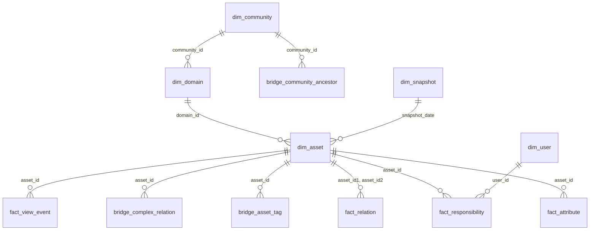

# Modelling Insights data

The raw tables mirror Collibra's operating model: flexible, but awkward for reporting. This guide explains the shape we recommend and why. Column details: [data-dictionary.md](data-dictionary.md). Worked questions: [cookbook.md](cookbook.md).

## 1. Why model at all?

Four properties of the raw tables make naive queries wrong:

| Raw table | Quirk | What goes wrong |
|---|---|---|
| `relation` | each link stored **twice** (head→tail and tail→head) | every count doubles |
| `community` | one row per **ancestor level** | communities repeat |
| `attribute` | one row per value for **every** attribute type (EAV) | you cannot see "a term with its definition" without pivoting |
| `responsibility` | resource may be missing from the export, may be null (global), may point at non-catalog resources | joins silently drop rows |

## 2. Target: a small star schema

| Layer | View | One row per… | Built from |
|---|---|---|---|
| Dim | `dim_community` | community (`depth`, `is_root`) | `community` |
| Dim | `dim_domain` | domain, with its community | `domain` ⨝ `dim_community` |
| Dim | `dim_asset` | asset, with domain / community; `is_domain_missing` | `asset` ⟕ `dim_domain` |
| Dim | `dim_user` | user (derived: there is no user table) | `responsibility` |
| Dim | `dim_snapshot` | snapshot date (`is_month_end`) | `asset` |
| Fact | `fact_attribute` | attribute value (`value_as_text` always filled when any value exists) | `attribute` |
| Fact | `fact_relation` | relationship (one direction kept) | `relation` |
| Fact | `fact_responsibility` | responsibility, with `asset_resolution` | `responsibility` |
| Fact | `fact_view_event` | page view (**only if `view_events` exists**) | `view_events` |
| Bridge | `bridge_community_ancestor` | community × ancestor level | `community` |
| Bridge | `bridge_asset_tag` | asset × tag | `asset_tag` |
| Bridge | `bridge_complex_relation` | complex relation × leg | `complex_relation` |



Why a star? "How many Business Terms per domain, owned by whom, with or without a definition?" becomes one fact joined to a few small dimensions.

## 3. Decisions that matter

**a) Snapshots are the time axis.** Keep `snapshot_date` on every view and join on `(snapshot_date, id)` (Collibra's own rule). Loading month-end snapshots gives cheap trends; daily snapshots give detail for the last 31 days.

**b) Keep attributes long; pivot per asset type.** `expression_long` holds a text rendering of almost every value; `numeric_value`, `boolean_value`, `datetime_value` hold the typed value for NUMERIC, BOOLEAN and DATE kinds. Compute with the typed column, display the text. A global pivot is unstable because custom attribute types differ per environment, so build wide marts only for the asset types you care about (e.g. `mart_business_term`: definition, status, owner).

**c) Keep one direction of each relation.** `fact_relation` filters `direction = 'head -> tail'`. Both ends are still reachable by testing `asset_id1` **or** `asset_id2`.

**d) Community hierarchy.** Official tip: `community_id = level_community_id` isolates unique communities. `dim_community` does this, and `bridge_community_ancestor` keeps the full path (level 1 = top, last level = the community itself).

**e) Never drop unmatched rows.** `LEFT JOIN` from facts to dimensions. Rows pointing at hidden built-in objects or at non-catalog resources are normal; `is_domain_missing` and `asset_resolution` label them rather than hiding them.

**f) Responsibilities need care.** Interpret with the rules in [known-gaps.md](known-gaps.md): asset-level and domain-inherited ownership are present, community-inherited is not, null means global. Use `asset_resolution = 'in_export'` for "who owns what".

**g) Direct and inherited responsibilities are indistinguishable.** One domain-level assignment is expanded into a row per asset of the domain. Count *distinct people per asset* rather than rows per person, or use the cookbook recipe *Which responsibilities look like domain-level assignments?* to find assignments that cover a whole domain.

**h) Privacy.** `responsibility` and `view_events` hold personal data (names, emails, usernames, sessions). `dim_user` omits names and email unless you ask (`build_model(snapshot, include_pii=True)`).

## 4. The model in code

```python
from collibra_toolkit.insights import Snapshot, build_model, check_model
snap = Snapshot("snapshots/insights-2026-10-10")   # or a parent folder holding several snapshots
build_model(snap)                                   # creates the views above
snap.sql("select asset_type_name, count(*) from dim_asset group by 1").fetchall()
```
CLI: `collibra-insights query <path> --model --file q.sql`.

## 5. Conformance checks (`collibra-insights check <snapshot>`)

| Check | Expect |
|---|---|
| `asset_missing_domain`, `domain_missing_community` | usually small, non-zero: hidden built-in parents |
| `attribute_missing_asset`, `asset_tag_missing_asset`, `relation_missing_asset` | 0 |
| `responsibility_missing_asset` | non-zero is normal: Data Quality resources, meta assets |
| `relation_ids_not_stored_twice` | 0 |
| `dim_asset_duplicate_keys`, `dim_community_duplicate_keys` | 0 |
| `community_parent_mismatch` | 0 (the second-deepest level equals `parent_community_id`) |

Anything unexpected is worth a look with `collibra-insights investigate`.

## 6. Using the model outside DuckDB

If a client wants to run these transformations in their own engine, note that the SQL here is **DuckDB dialect**. Translate:

| DuckDB construct | Translate to |
|---|---|
| `SELECT DISTINCT ON (a, b) …` (`dim_community`, `dim_user`) | `ROW_NUMBER() OVER (PARTITION BY a, b ORDER BY …) = 1` |
| `string_agg(x, ',' ORDER BY y)` | the engine's ordered aggregate |
| `… - INTERVAL 365 DAY` | the engine's date arithmetic |
| `any_value`, `hash`, `::INT` casts | `ANY_VALUE`/`MIN`, the engine's hash, `CAST(… AS INT)` |

Not tried on any specific engine; check Hive-partition support and type mapping on the first load.
